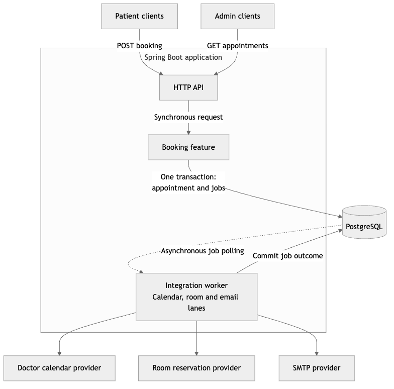

# ADR 001: One Spring Boot application organized by feature

Status: accepted.

## Context

The service must prevent overbooking while coordinating external calendar, room and email systems. It should handle thousands of requests per hour and remain easy to run, review and extend. External failures must not undo a committed local booking.

## Decision

Use one containerized Spring Boot application, organized into booking and integration features, with PostgreSQL as the shared persistence layer. Booking commits synchronously. External work runs asynchronously from durable database jobs in the same application.

[Editable Mermaid source](../../output/diagrams/architecture.mmd)

The booking flow registers jobs through a booking-owned port implemented by integration. The transaction covers both features' writes. Worker lanes independently synchronize calendar and room reservations, then submit email once both succeed. The local demo provides contract stubs and Mailpit at those external boundaries.

This structure supports transactional booking consistency and durable recovery without introducing a message broker, distributed transactions or separately deployed services. The load/recovery runners provide evidence for the chosen workload and failure modes.

## Consequences

One deployable application and one database keep setup and operations small. Feature-local application logic depends on ports, allowing adapters to evolve independently. Application instances can share the database; constraints protect bookings and row locks coordinate job execution.

The features share deployment and database capacity. Worker calls hold database connections during provider requests, and worker throughput scales with application instances. Independent service scaling or a separate queue can be reconsidered if measured capacity or organizational needs require it.

## Related decisions

- [Booking consistency and idempotency](002-booking-consistency.md)
- [Durable post-booking processing](003-post-booking-processing.md)
- [Feature boundaries and ports](004-feature-boundaries.md)

[README](../../README.md)
