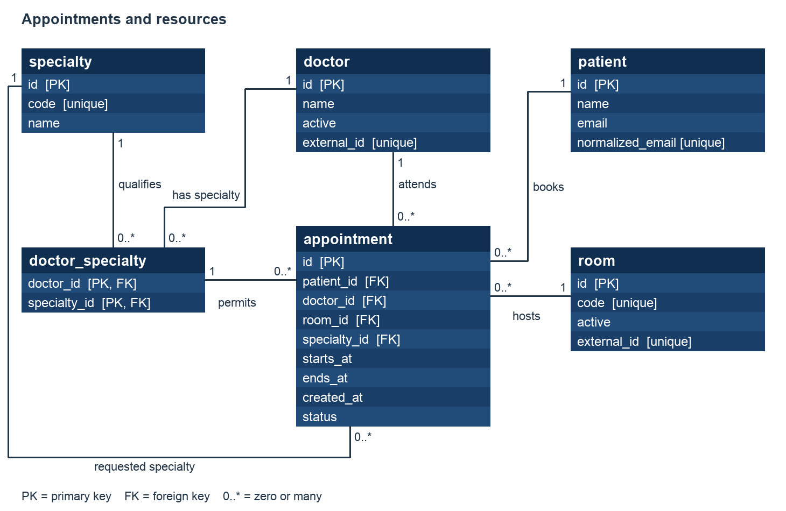
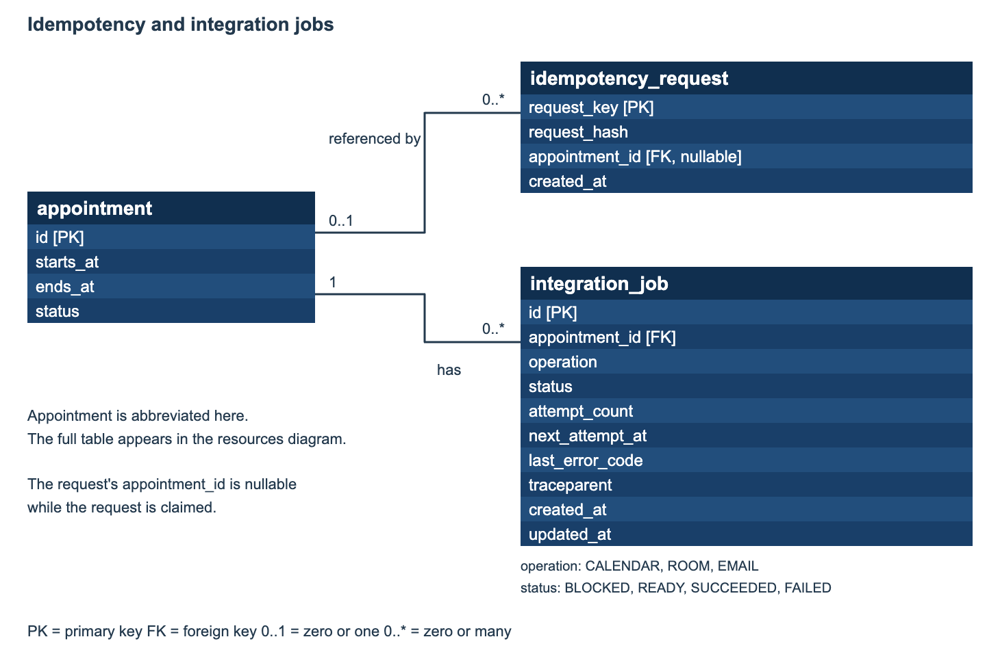

# Database model

These diagrams describe the Flyway schema. PK = primary key; FK = foreign key. Cardinalities show what the database permits; the booking transaction additionally creates exactly three jobs per appointment.

[README](../README.md#database-model-and-booking-consistency)

## Appointments and resources

`doctor_specialty` uses `(doctor_id,specialty_id)` as its composite key. Appointment references that pair directly, so qualification cannot disagree with its chosen doctor/specialty. Keeping doctor ID on appointment also lets the doctor-overlap constraint apply across specialties; an association ID alone would not prevent overlap between different specialties of the same doctor. Individual doctor/specialty foreign keys are redundant existence checks.

Patient name/email live in `patient`, not appointment. Normalized email is unique; booking reuses the patient without updating details. Appointment intervals use `timestamptz`, a positive-duration CHECK, and GiST exclusion constraints for doctor, room, and patient overlap.

## Idempotency and integration jobs

Appointment is abbreviated in this second diagram; its full columns appear above. The idempotency appointment reference is nullable during claim, then filled before booking commits. The FK permits multiple keys to reference one appointment, although normal creation links one request key to its booking.

Unique `(appointment_id,operation)` permits one job of each kind. CHECK constraints restrict operations/statuses and prevent negative attempt counts. A transaction-scoped row lock represents in-flight processing. Progress is derived from job outcomes rather than stored on the appointment. `traceparent` carries correlation identifiers, without patient data or request baggage.

## Consistency and indexes

One transaction owns request claiming, patient resolution, allocation, appointment creation and job registration. The allocation order is doctor then room. Range predicates use `tstzrange(..., '[)') && tstzrange(...)`, matching the exclusion constraints' GiST expressions.

| Database structure | Purpose |
|---|---|
| Unique patient `normalized_email` | Resolve one patient identity across concurrent requests |
| Doctor/specialty composite FK | Ensure the assigned doctor has the requested specialty |
| `doctor_overlap`, `room_overlap`, `patient_overlap` exclusion constraints | Reject overlapping intervals across application instances |
| Appointment `(starts_at, id)` index | Ordered keyset pagination and start-range filtering |
| Doctor/specialty `(specialty_id, doctor_id)` index | Qualified-doctor lookup |
| Integration job `(status, next_attempt_at)` index | Ready/due job selection |
| Unique job `(appointment_id, operation)` | Prevent duplicate job types for an appointment |

[ADR 002](adr/002-booking-consistency.md) explains consistency and replay. [ADR 003](adr/003-post-booking-processing.md) explains job ownership and recovery. [Query-plan evidence](performance/availability-plans.md) shows how the range predicates use the existing indexes. [Migration/catalog guidance](operations.md#migrations-and-demo-catalog) covers schema and demo-data changes.
